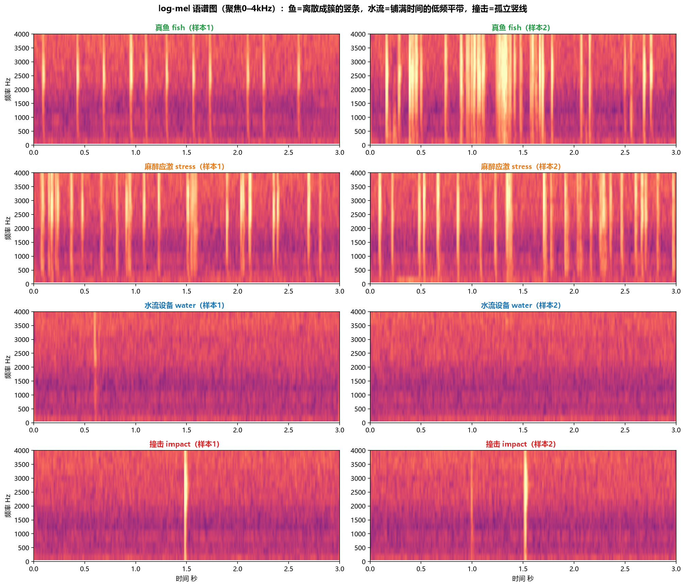
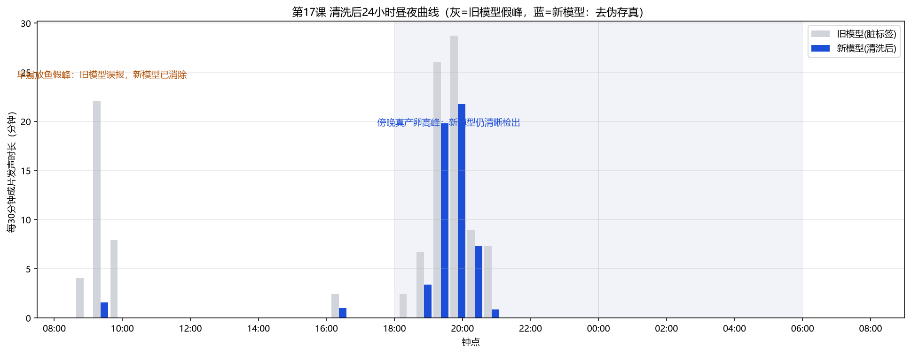
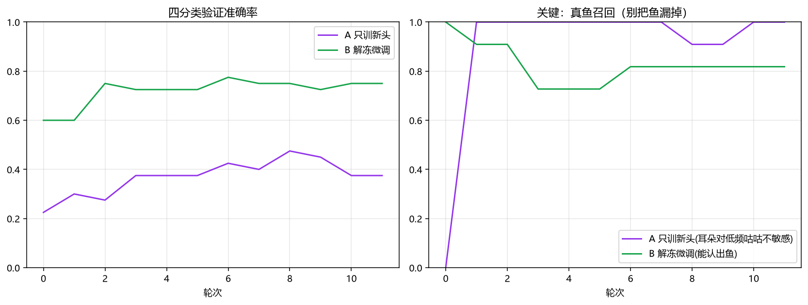
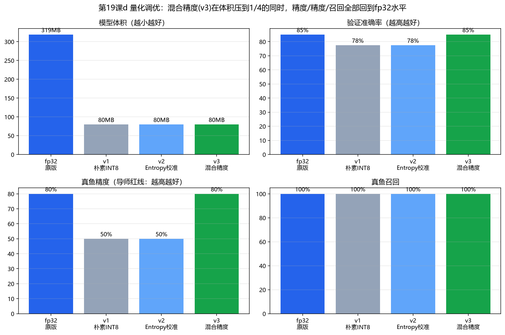
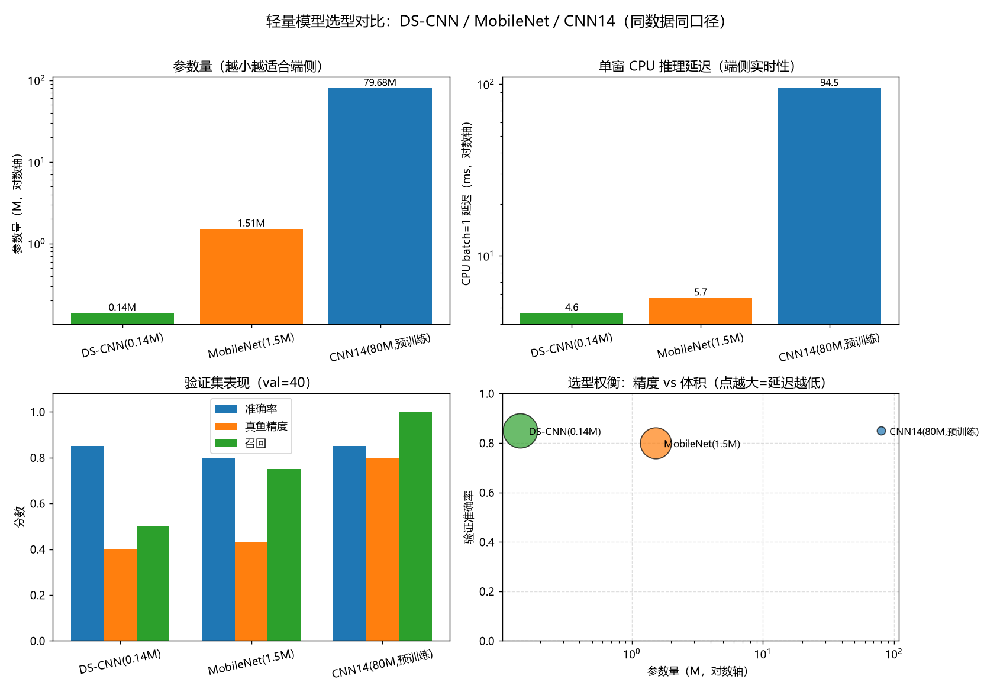
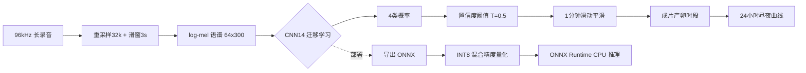
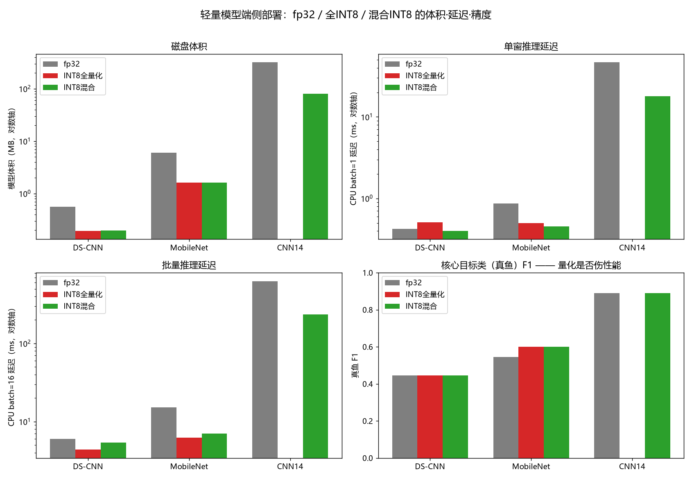

# 大黄鱼声信号分类与产卵发声检测

**基于 log-mel 特征 + CNN14 迁移学习的水产声信号事件检测系统，含完整数据清洗闭环、ONNX 部署与 INT8 混合精度量化。**


---

## 一、项目背景

大黄鱼（*Larimichthys crocea*）在繁殖期会发出特征性的成组"咕咕"声，发声强度与产卵
活动高度相关。通过**被动水声监听（Passive Acoustic Monitoring）**自动识别发声时段，
可以无干扰地刻画其**昼夜产卵规律**和**全生命周期发声发育**，替代昂贵的人工值守，
也为声学资源评估、智慧养殖提供数据支撑。

本项目要解决的工程问题：

1. 从含水流、设备、撞击、鱼群应激等干扰的长录音中，**高精度区分"真鱼发声"与噪声**；
2. 自动扫描全天 24 小时录音，输出**昼夜产卵曲线**；
3. 把训练好的模型**压缩并部署到 CPU 端**，可在低算力设备上实时推理。

> 导师口径：**"允许漏掉鱼声，但上报的必须是鱼声"** —— 因此全系统按**精度优先
> （Precision-first）、宁漏勿错**设计，把误报率压到 0。

---

## 二、核心成果

| 环节 | 结果 |
| --- | --- |
| 数据集 | 4 类声事件 162 段，按**源录音段**分组划分 train122 / val40，杜绝泄漏 |
| 模型 | CNN14（PANNs，AudioSet 527 类预训练耳朵）+ 迁移学习，约 80M 参数 |
| 验证准确率 | 85%；在阈值 T=0.5 下 **真鱼精度 100%、误报 0、召回 73%** |
| 昼夜曲线 | 自动检出傍晚 18:51–20:51 产卵高峰；清洗后**消除早晨放鱼作业假峰** |
| 模型部署 | fp32 304 MB → INT8 混合精度 **76 MB（4.0×压缩）** |
| 推理提速 | CPU batch=16 延迟约 645 ms → **约 240 ms（2.7×）**，验证集 **40/40 分类完全一致、准确率均 85%** |
| 模型选型 | 对比 DS-CNN(0.14M) / MobileNet(1.5M) / CNN14(80M)：轻量模型**端侧延迟降 16–20×、体积缩 565×**，但 162 段小样本下核心的"真鱼"召回显著下降（见第六章） |

### 关键结果图

**四类声音在 log-mel 语谱上形态差异明显：**



**数据清洗"去伪存真"：脏标签模型在早晨制造假峰，干净模型只保留傍晚真实产卵峰。**



**迁移学习：冻结全部卷积（只训头）会"见啥都叫鱼"，微调后准确率与召回更均衡。**



**混合精度量化：在保持 fp32 准确率的同时，体积与延迟大幅下降。**



**模型选型：轻量模型在整体准确率上接近大模型，但在小样本 + 稀有目标类（真鱼）上被预训练大模型拉开差距。**



更多图见 [`results/`](results/)。

---

## 三、技术方案（端到端管线）



真鱼声的**可解释物理特征**（也是人工标注与规则基线的依据）：

- 成组双/三脉冲，组内间隔 40–100 ms，组间规律长停顿（约 360–420 ms）
- 峰频约 688–900 Hz，窄带，脉宽（半高全宽）约 3–4 ms，低频底噪干净
- 对照：孤立宽频"咚"=撞击；连续密集杂乱扑腾=应激；均匀节拍+宽频低轰鸣=水流设备

---

## 四、目录结构

```
fish-sound-classification/
├── src/fishsound/          # 核心包（可复用、可 import）
│   ├── config.py           # 音频/mel/阈值/路径配置
│   ├── features.py         # 音频读取 + log-mel（纯 numpy/soxr 手写，不依赖 librosa/numba）
│   ├── models.py           # CNN14（预训练）+ DS-CNN/MobileNet 轻量模型 + 部署外壳
│   ├── data.py             # manifest 读取、张量组装、Dataset
│   ├── augment.py          # 波形增强 + SpecAugment
│   ├── metrics.py          # 混淆矩阵 / 精度 / 召回 / F1
│   ├── train.py            # 迁移学习 & 从零训练（加权CE/AMP/梯度累积/BN冻结）
│   ├── infer.py            # PyTorch/ONNX 双后端滑窗扫描、成片检测
│   └── deploy.py           # ONNX 导出/数值校验/INT8量化/延迟基准
├── scripts/                # 端到端入口（6 个）
│   ├── 01_train.py         # CNN14 迁移学习训练
│   ├── 02_scan.py          # 单文件 / 全天扫描出昼夜曲线
│   ├── 03_export_onnx.py   # 导出 ONNX 并校验
│   ├── 04_quantize.py      # CNN14 INT8 混合精度量化与对比
│   ├── 05_model_compare.py # 三模型选型对比（参数量/精度/CPU延迟）
│   └── 06_deploy_lightweight.py # 轻量模型 ONNX/INT8 端侧部署对比
├── tutorials/              # 从 0 到 1 的 52 个带中文注释学习脚本（8 阶段）
├── results/                # 精选结果图
├── data/                   # 数据目录（不入库，见 data/README.md）
└── configs/
```

---

## 五、快速开始

### 1. 安装环境

```bash
python -m venv .venv
# Windows: .venv\Scripts\activate    Linux: source .venv/bin/activate
pip install -r requirements.txt
# 再按 CUDA 版本安装 torch（见 requirements.txt 末尾注释）
```

### 2. 配置数据路径（任选一种）

- 把数据放进 `data/`（结构见 `data/README.md`）；或
- 设环境变量 `FISH_DATA_ROOT`、`FISH_MODEL_DIR`、`FISH_REC_DIR`；或
- 运行时用 `--data-root` / `--model-dir` 参数指定。

### 3. 训练（CNN14 迁移学习）

```bash
python scripts/01_train.py              # 复现干净模型
python scripts/01_train.py --augmented  # 开启 SpecAugment
```

### 4. 扫描长录音，出昼夜曲线

```bash
python scripts/02_scan.py --file "某段30分钟录音.wav"   # 单文件
python scripts/02_scan.py --dir "全天录音目录"           # 全天 48 段
```

### 5. 部署：导出 ONNX 与 INT8 量化

```bash
python scripts/03_export_onnx.py
python scripts/04_quantize.py
python scripts/05_model_compare.py    # 可选：DS-CNN/MobileNet/CNN14 选型对比
python scripts/06_deploy_lightweight.py  # 可选：轻量模型 ONNX/INT8 端侧部署
```

导出时会在 ONNX 旁边生成一个 `*.onnx.preprocess.json`，记录标准化参数（mean/std）
与类别名。ONNX 图本身不含标准化（输入要求 `(mel-mean)/std` 后的 log-mel），
`FishSoundDetector` 加载 ONNX 时会自动读取该文件完成预处理——**跨语言部署时务必
带上它，或在部署代码里按其中参数做同样的标准化**。量化脚本会先校验敏感层节点
真实存在（节点名对不上会直接报错，而不是静默退化成全量化掉精度）。

### 6. 作为库调用

```python
from fishsound.infer import FishSoundDetector, detect_segments

det = FishSoundDetector("cnn14_v2_int8_mix.onnx")   # INT8 模型，CPU 即可
mid_sec, fish_prob, _ = det.scan_file("recording.wav")
for start, end, peak, _ in detect_segments(mid_sec, fish_prob):
    print(f"检测到产卵发声：{start:.1f}~{end:.1f} 分钟")
```

---

## 六、模型选型对比：端侧到底要不要换轻模型？

为回答"CNN14 80M 参数太大，端侧能不能换轻量模型"，在**同一份数据、同一份 log-mel
特征、同一套标准化、同一套训练口径（加权 CE / AdamW / AMP / seed42 / 按验证集取最佳）**
下，对比三档网络：

- **DS-CNN**（0.14M，从零训练）：ARM 关键词唤醒风格的窄深网络，深度可分离卷积；
- **MobileNet**（1.5M，从零训练）：MobileNet-V1 风格、通道更宽的深度可分离卷积网络；
- **CNN14**（79.7M，AudioSet 预训练 + 迁移学习）。

复现：`python scripts/05_model_compare.py`（CPU 延迟为 batch=1/16、30 次推理中位数）。

| 模型 | 参数量 | fp32 体积(约) | 准确率 | **真鱼精度** | **真鱼召回** | 真鱼 F1 | CPU b1 | CPU b16 |
| --- | --- | --- | --- | --- | --- | --- | --- | --- |
| DS-CNN | 0.14M | 0.56 MB | 85% | 40% | 50% | 44% | **4.6 ms** | **32.8 ms** |
| MobileNet | 1.5M | 6.1 MB | 80% | 43% | 75% | 55% | 5.7 ms | 48.7 ms |
| **CNN14（预训练）** | 79.7M | 319 MB | 85% | 80% | **100%** | **89%** | 94.5 ms | 923.9 ms |

**三条工程结论（比数字本身更重要）：**

1. **类别不平衡时，准确率会骗人。** 验证集 40 个里真鱼只有 4 个、非鱼 36 个。DS-CNN
   只要把多数非鱼判对，准确率就能到 85%，但它漏掉了一半真鱼（召回 50%）。所以在"关注
   稀有目标类"的任务里，必须看**该类的精度/召回/F1**，不能只看整体 accuracy。
2. **预训练的价值在小样本被放大。** CNN14 靠 AudioSet 527 类预训练的"耳朵"，在仅 122
   个训练样本上仍做到真鱼召回 100%、F1 89%；两个从零训练的小模型在这么小的数据上
   **训练不稳定**（loss 大幅波动、20 轮后快速过拟合），真鱼 F1 只有 44%/55%——它们的
   瓶颈不是结构，而是**数据量**。
3. **轻量模型的优势是真实的，但要看阶段。** DS-CNN 单窗延迟仅为 CNN14 的 **1/20**、
   体积仅 **1/565**，在数据充足、算力受限的端侧（MCU/手机/水下发声节点）是正确选择。

**选型决策：** 本项目当前（162 段小样本、精度优先）继续用 CNN14；待 16 TB 全生命周期
数据到位后，用**知识蒸馏**把 CNN14 的"鱼声判别能力"迁移到 DS-CNN/MobileNet，并配合
数据增强，可望在保持目标类召回的同时拿到端侧的小体积与低延迟——这是比"无脑换小模型"
更稳的工程路线。

### 端侧部署实测（`scripts/06_deploy_lightweight.py`）

对两个轻量模型导出 ONNX 并做 INT8 量化（ONNX Runtime CPU，Entropy 校准、QDQ、per-channel）：

| 模型 | 版本 | 体积 | CPU b1 | CPU b16 | 准确率 | 真鱼 F1 |
| --- | --- | --- | --- | --- | --- | --- |
| **DS-CNN** | fp32 | 0.56 MB | 0.42 ms | 6.0 ms | 85% | 44% |
| **DS-CNN** | **INT8 混合** | **0.20 MB** | **0.40 ms** | 5.4 ms | 85% | 44% |
| MobileNet | fp32 | 6.05 MB | 0.86 ms | 15.1 ms | 80% | 55% |
| MobileNet | INT8 全量化 | 1.62 MB | 0.50 ms | 6.2 ms | 82% | 60% |
| CNN14 | fp32 | 318.7 MB | 46.6 ms | 628 ms | 85% | 89% |
| CNN14 | INT8 混合 | 80.0 MB | 17.9 ms | 234.6 ms | 85% | 89% |



要点：

- **压缩到极致**：DS-CNN 混合 INT8 仅 **0.20 MB（约 200 KB）**、单窗 **0.40 ms**；相比
  CNN14 fp32 体积小约 **1600 倍**、单窗快约 **117 倍**，可直接塞进 MCU / 低功耗水声节点。
  3 秒窗只花 0.4 ms，相当于约 **7500 倍实时**，CPU 占用几乎可忽略。
- **量化本身几乎无损**：DS-CNN 混合精度准确率保持 85%（全量化掉 3%，保留首层 stem 卷积
  与分类头 fp32 后恢复）；MobileNet 全量化真鱼 F1 反而 55%→60%。轻量模型当前的 F1 偏低是
  **训练数据太少**导致，不是量化导致——量化前后 F1 一致。
- **ONNX Runtime 对小模型优化显著**：同一 DS-CNN，PyTorch CPU b1 为 4.6 ms，ONNX 仅
  0.42 ms（约 11 倍），这也是部署要走 ONNX 而非直接跑 PyTorch 的原因。

---

## 七、技术亮点（面试可讲）

1. **规则基线 → 深度学习的完整演进**：先做基于物理特征（峰频/带宽/成组）的"四道关"
   规则检测器并建立精度/召回/F1 评估体系，再用 CNN14 对比，能讲清"为什么要用深度学习"。
2. **迁移学习解决小样本**：数据仅 162 段，复用 AudioSet 527 类预训练"耳朵"，只微调
   最后两块卷积 + 分类头；对比了"只训头（欠拟合，乱报鱼）"与"微调（均衡）"两条策略。
3. **数据清洗闭环（项目最有价值的部分）**：用模型反查可疑标签、人工耳听复核、客观特征
   双重校验、按源段重划分，再重训 —— 干净模型消除了早晨放鱼作业导致的**假产卵峰**。
4. **精度优先的阈值策略**：用置信度阈值扫描找到满足"误报=0"的工作点（T=0.5），
   用滑动平均 + 成片连续性约束抑制瞬时误报。
5. **工程化部署能力**：PyTorch → ONNX → ONNX Runtime；静态量化（QDQ、Entropy 校准、
   per-channel）；**朴素量化掉精度 → 定位到首层卷积与分类头敏感 → 混合精度解决**，
   最终 4× 压缩、2.7× 提速且分类结果 100% 一致。
6. **严谨的实验习惯**：类别加权交叉熵、AMP 混合精度、梯度累积、冻结层 BN 处理、
   按源段划分防数据泄漏、数据增强消融（并诚实报告"小样本下增强收益有限、数据才是瓶颈"）。
7. **可移植的音频前端**：在 librosa 1.0 / numba 0.67 环境下，`load` 重采样与
   `melspectrogram` 会因多线程 JIT 初始化卡死（3 秒音频数十秒不返回）。于是用
   soundfile + soxr + 纯 numpy 手写整套前端（重采样、补零中心 STFT、periodic hann、
   Slaney mel 滤波器、功率谱 dB），参数与 librosa 严格对齐（fp32 准确率仍 85% 验证
   口径一致），不依赖 numba、更易移植到 C++/端侧；同时给量化节点加了存在性校验，
   防止敏感层节点名不匹配时静默失效。
8. **模型选型与端侧权衡**：在统一口径下对比 DS-CNN（0.14M）、MobileNet（1.5M）、
   CNN14（80M）的参数量、CPU 延迟、准确率与**目标类 P/R/F1**，用数据讲清"轻量模型
   快 20×、小 565×，但在小样本 + 稀有目标类上召回不足"，并给出"先预训练大模型、
   数据到位后知识蒸馏到端侧"的分阶段路线，而不是盲目追小或盲目追大。
9. **端侧极致压缩落地**：把 DS-CNN 经 ONNX → INT8 混合量化后压到 **0.20 MB、CPU 单窗
   0.4 ms（约 7500 倍实时）**，相比 CNN14 fp32 体积小 1600 倍、快 117 倍；并验证量化
   在轻量模型上几乎无损（首层/分类头保留 fp32），具备 MCU / 低功耗水声节点部署能力。

---

## 八、学习路线（`tutorials/`，52 个带中文注释脚本）

| 阶段 | 内容 |
| --- | --- |
| 01 音频基础 | 读音频、波形/语谱、测峰频、数脉冲间隔、测脉宽带宽 |
| 02 规则检测器 | 四道关检测、阈值原理、精度/召回/F1、规则 vs CNN |
| 03 神经网络入门 | 学习率、训练过程可视化、亲手训练、防过拟合 |
| 04 迁移学习 | 冻结 vs 微调、首次推理、置信度阈值 |
| 05 推理与昼夜曲线 | 滑窗扫描、成片检测、全天 24 小时曲线 |
| 06 数据清洗闭环 | 标签审查、耳听复核、客观特征、重训、干净曲线 |
| 07 数据增强 | 波形增强、SpecAugment、过拟合 gap 消融 |
| 08 部署量化 | 导出 ONNX、延迟/体积基准、INT8 量化与调优 |

---

## 九、局限与后续工作

- 现有验证集真鱼仅 4 例，阈值与指标波动较大；**接 16 TB 全生命周期数据后需在更大
  验证集上重定阈值**，并对幼鱼首次发声弱声做专项人工复核。
- 成片门限（平滑窗 20、平滑阈值 0.30、最短 1.5 分钟）在更保守的干净模型上偏严：
  单窗报鱼（T=0.5）能正确定位傍晚 22–29 分钟产卵峰，但 1 分钟平滑后峰值可能低于
  0.30 而未连成"成片"时段，需随大数据一起重标定。
- 覆盖鱼苗 3.12–3.24（蝌蚪期，尚未发声）；"首次发声"拐点需更晚的录音（约 4 月中下旬）。
- 轻量模型在当前 162 段小样本下真鱼召回不足（DS-CNN 50%、MobileNet 75%，对比 CNN14
  100%），训练曲线波动大；下一步是接入 16 TB 数据后做**知识蒸馏（CNN14→轻量模型）+
  数据增强**，再评估端侧落地。
- 后续：接入更大规模数据做半监督/伪标签；轻量模型蒸馏后 ONNX/INT8 端侧部署；
  实时流式推理；C++ 端侧部署；波束成形/阵列定位扩展。

---

## 技术栈

Python · PyTorch · soundfile / soxr · NumPy · SciPy · scikit-learn ·
ONNX / ONNX Runtime · Matplotlib

> 音频前端（重采样 / STFT / mel）由 NumPy + SciPy 手写，**运行时不依赖 librosa /
> numba**（librosa 仅在 requirements 中列为可选参考），因此前端可直接对照移植到
> C++/端侧，也不会触发 numba JIT 多线程卡死。

## License

[MIT](LICENSE)
