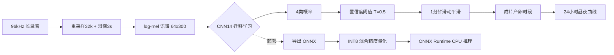

# 大黄鱼声信号分类与产卵发声检测

**基于 log-mel 特征 + CNN14 迁移学习的水产声信号事件检测系统，含完整数据清洗闭环、ONNX 部署与 INT8 混合精度量化。**


---

## 一、项目背景

大黄鱼（*Larimichthys crocea*）在繁殖期会发出特征性的成组"咕咕"声，发声强度与产卵
活动高度相关。通过**被动水声监听（Passive Acoustic Monitoring）**自动识别发声时段，
可以无干扰地刻画其**昼夜产卵规律**和**全生命周期发声发育**，替代昂贵的人工值守，
也为声学资源评估、智慧养殖提供数据支撑。

本项目要解决的工程问题：

1. 从含水流、设备、撞击、鱼群应激等干扰的长录音中，**高精度区分"真鱼发声"与噪声**；
2. 自动扫描全天 24 小时录音，输出**昼夜产卵曲线**；
3. 把训练好的模型**压缩并部署到 CPU 端**，可在低算力设备上实时推理。

> 导师口径：**"允许漏掉鱼声，但上报的必须是鱼声"** —— 因此全系统按**精度优先
> （Precision-first）、宁漏勿错**设计，把误报率压到 0。

---

## 二、核心成果

| 环节 | 结果 |
| --- | --- |
| 数据集 | 4 类声事件 162 段，按**源录音段**分组划分 train122 / val40，杜绝泄漏 |
| 模型 | CNN14（PANNs，AudioSet 527 类预训练耳朵）+ 迁移学习，约 80M 参数 |
| 验证准确率 | 85%；在阈值 T=0.5 下 **真鱼精度 100%、误报 0、召回 73%** |
| 昼夜曲线 | 自动检出傍晚 18:51–20:51 产卵高峰；清洗后**消除早晨放鱼作业假峰** |
| 模型部署 | fp32 304 MB → INT8 混合精度 **76 MB（4.0×压缩）** |
| 推理提速 | CPU batch=16 延迟约 645 ms → **约 240 ms（2.7×）**，验证集 **40/40 分类完全一致、准确率均 85%** |

### 关键结果图

**四类声音在 log-mel 语谱上形态差异明显：**


**数据清洗"去伪存真"：脏标签模型在早晨制造假峰，干净模型只保留傍晚真实产卵峰。**


**迁移学习：冻结全部卷积（只训头）会"见啥都叫鱼"，微调后准确率与召回更均衡。**


**混合精度量化：在保持 fp32 准确率的同时，体积与延迟大幅下降。**


更多图见 [`results/`](results/)。

---

## 三、技术方案（端到端管线）



真鱼声的**可解释物理特征**（也是人工标注与规则基线的依据）：

- 成组双/三脉冲，组内间隔 40–100 ms，组间规律长停顿（约 360–420 ms）
- 峰频约 688–900 Hz，窄带，脉宽（半高全宽）约 3–4 ms，低频底噪干净
- 对照：孤立宽频"咚"=撞击；连续密集杂乱扑腾=应激；均匀节拍+宽频低轰鸣=水流设备

---

## 四、目录结构

```
fish-sound-classification/
├── src/fishsound/          # 核心包（可复用、可 import）
│   ├── config.py           # 音频/mel/阈值/路径配置
│   ├── features.py         # 音频读取 + log-mel（纯 numpy/soxr 手写，不依赖 librosa/numba）
│   ├── models.py           # CNN14 结构、AudioSet 预训练加载、部署外壳
│   ├── data.py             # manifest 读取、张量组装、Dataset
│   ├── augment.py          # 波形增强 + SpecAugment
│   ├── metrics.py          # 混淆矩阵 / 精度 / 召回 / F1
│   ├── train.py            # 迁移学习训练（加权CE/AMP/梯度累积/BN冻结）
│   ├── infer.py            # PyTorch/ONNX 双后端滑窗扫描、成片检测
│   └── deploy.py           # ONNX 导出/数值校验/INT8量化/延迟基准
├── scripts/                # 端到端入口（4 个）
│   ├── 01_train.py         # 训练
│   ├── 02_scan.py          # 单文件 / 全天扫描出昼夜曲线
│   ├── 03_export_onnx.py   # 导出 ONNX 并校验
│   └── 04_quantize.py      # INT8 混合精度量化与对比
├── tutorials/              # 从 0 到 1 的 52 个带中文注释学习脚本（8 阶段）
├── results/                # 精选结果图
├── data/                   # 数据目录（不入库，见 data/README.md）
└── configs/
```

---

## 五、快速开始

### 1. 安装环境

```bash
python -m venv .venv
# Windows: .venv\Scripts\activate    Linux: source .venv/bin/activate
pip install -r requirements.txt
# 再按 CUDA 版本安装 torch（见 requirements.txt 末尾注释）
```

### 2. 配置数据路径（任选一种）

- 把数据放进 `data/`（结构见 `data/README.md`）；或
- 设环境变量 `FISH_DATA_ROOT`、`FISH_MODEL_DIR`、`FISH_REC_DIR`；或
- 运行时用 `--data-root` / `--model-dir` 参数指定。

### 3. 训练（CNN14 迁移学习）

```bash
python scripts/01_train.py              # 复现干净模型
python scripts/01_train.py --augmented  # 开启 SpecAugment
```

### 4. 扫描长录音，出昼夜曲线

```bash
python scripts/02_scan.py --file "某段30分钟录音.wav"   # 单文件
python scripts/02_scan.py --dir "全天录音目录"           # 全天 48 段
```

### 5. 部署：导出 ONNX 与 INT8 量化

```bash
python scripts/03_export_onnx.py
python scripts/04_quantize.py
```

导出时会在 ONNX 旁边生成一个 `*.onnx.preprocess.json`，记录标准化参数（mean/std）
与类别名。ONNX 图本身不含标准化（输入要求 `(mel-mean)/std` 后的 log-mel），
`FishSoundDetector` 加载 ONNX 时会自动读取该文件完成预处理——**跨语言部署时务必
带上它，或在部署代码里按其中参数做同样的标准化**。量化脚本会先校验敏感层节点
真实存在（节点名对不上会直接报错，而不是静默退化成全量化掉精度）。

### 6. 作为库调用

```python
from fishsound.infer import FishSoundDetector, detect_segments

det = FishSoundDetector("cnn14_v2_int8_mix.onnx")   # INT8 模型，CPU 即可
mid_sec, fish_prob, _ = det.scan_file("recording.wav")
for start, end, peak, _ in detect_segments(mid_sec, fish_prob):
    print(f"检测到产卵发声：{start:.1f}~{end:.1f} 分钟")
```

---

## 六、技术亮点（面试可讲）

1. **规则基线 → 深度学习的完整演进**：先做基于物理特征（峰频/带宽/成组）的"四道关"
   规则检测器并建立精度/召回/F1 评估体系，再用 CNN14 对比，能讲清"为什么要用深度学习"。
2. **迁移学习解决小样本**：数据仅 162 段，复用 AudioSet 527 类预训练"耳朵"，只微调
   最后两块卷积 + 分类头；对比了"只训头（欠拟合，乱报鱼）"与"微调（均衡）"两条策略。
3. **数据清洗闭环（项目最有价值的部分）**：用模型反查可疑标签、人工耳听复核、客观特征
   双重校验、按源段重划分，再重训 —— 干净模型消除了早晨放鱼作业导致的**假产卵峰**。
4. **精度优先的阈值策略**：用置信度阈值扫描找到满足"误报=0"的工作点（T=0.5），
   用滑动平均 + 成片连续性约束抑制瞬时误报。
5. **工程化部署能力**：PyTorch → ONNX → ONNX Runtime；静态量化（QDQ、Entropy 校准、
   per-channel）；**朴素量化掉精度 → 定位到首层卷积与分类头敏感 → 混合精度解决**，
   最终 4× 压缩、2.7× 提速且分类结果 100% 一致。
6. **严谨的实验习惯**：类别加权交叉熵、AMP 混合精度、梯度累积、冻结层 BN 处理、
   按源段划分防数据泄漏、数据增强消融（并诚实报告"小样本下增强收益有限、数据才是瓶颈"）。
7. **可移植的音频前端**：在 librosa 1.0 / numba 0.67 环境下，`load` 重采样与
   `melspectrogram` 会因多线程 JIT 初始化卡死（3 秒音频数十秒不返回）。于是用
   soundfile + soxr + 纯 numpy 手写整套前端（重采样、补零中心 STFT、periodic hann、
   Slaney mel 滤波器、功率谱 dB），参数与 librosa 严格对齐（fp32 准确率仍 85% 验证
   口径一致），不依赖 numba、更易移植到 C++/端侧；同时给量化节点加了存在性校验，
   防止敏感层节点名不匹配时静默失效。

---

## 七、学习路线（`tutorials/`，52 个带中文注释脚本）

| 阶段 | 内容 |
| --- | --- |
| 01 音频基础 | 读音频、波形/语谱、测峰频、数脉冲间隔、测脉宽带宽 |
| 02 规则检测器 | 四道关检测、阈值原理、精度/召回/F1、规则 vs CNN |
| 03 神经网络入门 | 学习率、训练过程可视化、亲手训练、防过拟合 |
| 04 迁移学习 | 冻结 vs 微调、首次推理、置信度阈值 |
| 05 推理与昼夜曲线 | 滑窗扫描、成片检测、全天 24 小时曲线 |
| 06 数据清洗闭环 | 标签审查、耳听复核、客观特征、重训、干净曲线 |
| 07 数据增强 | 波形增强、SpecAugment、过拟合 gap 消融 |
| 08 部署量化 | 导出 ONNX、延迟/体积基准、INT8 量化与调优 |

---

## 八、局限与后续工作

- 现有验证集真鱼仅 4 例，阈值与指标波动较大；**接 16 TB 全生命周期数据后需在更大
  验证集上重定阈值**，并对幼鱼首次发声弱声做专项人工复核。
- 成片门限（平滑窗 20、平滑阈值 0.30、最短 1.5 分钟）在更保守的干净模型上偏严：
  单窗报鱼（T=0.5）能正确定位傍晚 22–29 分钟产卵峰，但 1 分钟平滑后峰值可能低于
  0.30 而未连成"成片"时段，需随大数据一起重标定。
- 覆盖鱼苗 3.12–3.24（蝌蚪期，尚未发声）；"首次发声"拐点需更晚的录音（约 4 月中下旬）。
- 后续：接入更大规模数据做半监督/伪标签；轻量模型（MobileNet/DS-CNN）对比；
  实时流式推理；C++ 端侧部署；波束成形/阵列定位扩展。

---

## 技术栈

Python · PyTorch · soundfile / soxr · NumPy · SciPy · scikit-learn ·
ONNX / ONNX Runtime · Matplotlib

> 音频前端（重采样 / STFT / mel）由 NumPy + SciPy 手写，**运行时不依赖 librosa /
> numba**（librosa 仅在 requirements 中列为可选参考），因此前端可直接对照移植到
> C++/端侧，也不会触发 numba JIT 多线程卡死。

## License

[MIT](LICENSE)
